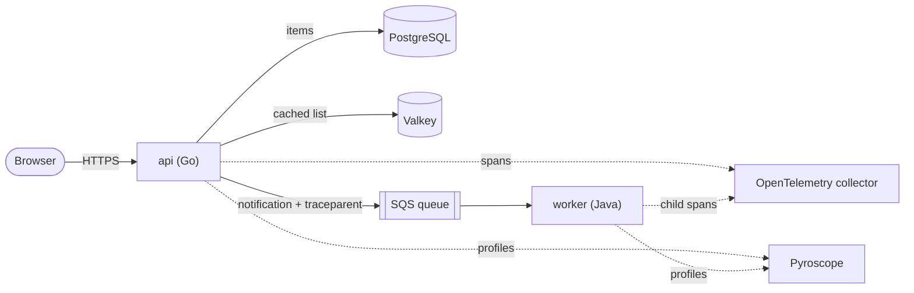
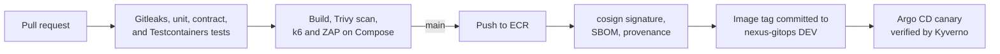

# Nexus Applications

Two small services that together exercise everything the Nexus platform
provides: HTTP traffic, PostgreSQL, a Valkey cache, an SQS queue, tracing,
metrics, and structured logs.

- `api` is a Go service that serves the web page and REST API, stores items in
  PostgreSQL, caches reads in Valkey, and queues notifications in SQS.
- `worker` is a Java 25 Spring Boot service that long-polls SQS and processes
  the notifications.

Each service folder is self-contained: its own dependencies, tests, and
Dockerfile, built with the folder as the Docker context.

The [architecture decision records](docs/adr/README.md) explain the main
choices.

## Documentation

| Page | Contents |
| --- | --- |
| [Architecture](docs/architecture.md) | Repository structure, the API, the worker, and the message contract |
| [Configuration](docs/configuration.md) | Environment variables of both services |
| [Local development](docs/local-development.md) | Running and testing everything on a laptop |
| [CI and delivery](docs/ci-cd.md) | Pipelines, releases, the `Deploy` workflow, and repository settings |
| [Decision records](docs/adr/README.md) | Why each major choice was made |

## Related repositories

- `nexus-platform`: the AWS infrastructure the services run on.
- `nexus-gitops`: the Kubernetes manifests; the `Deploy` workflow here writes
  image tags to its `environments/` folders.
