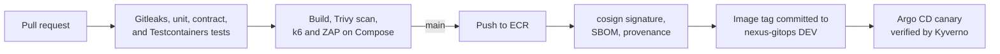

# Nexus Applications

Two small services that together exercise everything the Nexus platform
provides: HTTP traffic, PostgreSQL, a Valkey cache, an SQS queue, tracing,
metrics, and structured logs.

- `api` is a Go service that serves the web page and REST API, stores items in
  PostgreSQL, caches reads in Valkey, and queues notifications in SQS.
- `worker` is a Java 25 Spring Boot service that long-polls SQS and processes
  the notifications.

Each service folder is self-contained: its own dependencies, tests, and
Dockerfile, built with the folder as the Docker context.




The [architecture decision records](docs/adr/README.md) explain the main
choices.

## Structure

```text
services/
├── api/
│   ├── main.go                 Wiring: configuration, telemetry, dependencies, HTTP server lifecycle
│   ├── internal/
│   │   ├── config/             Environment variables
│   │   ├── items/              Item rules and the read-through cache
│   │   ├── notifications/      The notification message sent to the worker
│   │   ├── postgres/           Item storage and versioned schema migrations
│   │   ├── valkey/             Cache client and ElastiCache IAM authentication
│   │   ├── sqs/                Queue client that forwards the trace context
│   │   ├── server/             Routes, handlers, the OpenAPI document, and the embedded web page
│   │   └── telemetry/          Tracing, profiling, JSON logs, and Prometheus metrics
│   ├── go.mod
│   └── Dockerfile              Static binary in a scratch image
└── worker/
    ├── src/main/java/          SQS polling, message model, tracing, profiling, configuration
    ├── src/test/java/          Unit tests and the ElasticMQ integration test
    ├── pom.xml
    └── Dockerfile              Fat jar in a distroless Java 25 image
contracts/                      JSON Schema and example of the queue message, shared by both services
load/api.js                     k6 load test of the API
.zap/rules.tsv                  Alerts the ZAP scan may ignore, with the reason
release-please-config.json      How Release Please versions each service
docs/adr/                       Architecture decision records
local/elasticmq.conf            Local SQS queue and dead-letter queue
compose.yaml                    Complete local environment
compose.observability.yaml      Optional Grafana, Tempo, Loki, Prometheus, and Pyroscope
sonar-project.properties        Optional SonarQube analysis
```

Packages under `services/api/internal` depend inward: `server` calls the
`items` and `notifications` services, which define the interfaces that
`postgres`, `valkey`, and `sqs` implement. Business rules can therefore be
tested without any infrastructure.

## API

| Endpoint | Purpose |
| --- | --- |
| `GET /` | Web page |
| `GET /api/items`, `POST /api/items` | List and create items |
| `POST /api/notify` | Queue a notification for the worker |
| `GET /healthz` | Liveness: the process is running |
| `GET /readyz` | Readiness: PostgreSQL answers |
| `GET /metrics` | Prometheus metrics |
| `GET /api/openapi.yaml` | The OpenAPI 3 document of the endpoints above |

Item lists are read through Valkey: a miss reads PostgreSQL and fills the
cache, and creating an item clears it. Valkey is an optimization, so when it
fails the API logs a warning and serves from PostgreSQL, and readiness ignores
it.

At startup the API applies the versioned migrations in
`internal/postgres/migrations` with golang-migrate, which records the version
in `schema_migrations` and holds a PostgreSQL advisory lock, so pods that start
together apply each migration once. Because a canary runs the old and new
versions side by side, every migration must keep the previous version working:
add columns and tables first, remove them in a later release. In the
disaster-recovery standby region the database is a read replica, so the API
skips migrations, serves reads, and answers item creation with `503` until the
replica is promoted.

`internal/server/openapi.yaml` documents every application endpoint, and the
API serves it at `/api/openapi.yaml`. A contract test sends a request for each
documented operation and response code, validates both against the document,
and fails when an operation is documented but not tested. Every response
carries a strict Content Security Policy and cross-origin isolation headers,
and API responses are never cached.

Requests are traced with OpenTelemetry, and the trace context continues through
PostgreSQL, Valkey, and SQS. Logs are JSON and carry the `trace_id`. The
metrics cover the application routes (`nexus_http_requests_total`,
`nexus_http_requests_in_flight`) plus the Go runtime and process; probes and
`/metrics` are not counted or traced. When `PYROSCOPE_SERVER_ADDRESS` is set,
the API also sends CPU, allocation, heap, and goroutine profiles to Pyroscope.

## Worker

The worker long-polls SQS, validates each notification, and deletes a message
only after it has been processed. A message that fails stays in the queue, is
delivered again after the visibility timeout, and moves to the dead-letter
queue after repeated failures. On shutdown it finishes the batch in progress.

Each message is processed in an OpenTelemetry consumer span whose parent is
the API request that queued it, read from the `traceparent`, `tracestate`, and
`baggage` message attributes, so one trace in Tempo shows the request and the
work it caused. Logs are JSON in the Elastic Common Schema format and carry the
same `trace_id`. When `PYROSCOPE_SERVER_ADDRESS` is set, the worker sends CPU
and allocation profiles to Pyroscope. Spring Boot Actuator
serves `GET /livez`, `GET /readyz`, and `GET /metrics`, including
`nexus_worker_messages_total{outcome}` and
`nexus_worker_receive_failures_total`.

## Message contract

The API sends, and the worker accepts, this JSON body with a `traceparent`
message attribute:

```json
{"type": "notification.requested", "message": "hello", "createdAt": "2026-10-27T09:30:00Z"}
```

`contracts/notification.schema.json` is the single definition. The API's
tests validate every message it produces, and the shared example, against the
schema; the worker's tests read the same example. A change that breaks either
side fails CI for both services. The worker ignores fields it does not know, so
the API can add optional fields before the worker uses them.

## Configuration

| Variable | Service | Default | Purpose |
| --- | --- | --- | --- |
| `PORT` | both | `8080` | HTTP port |
| `AWS_REGION` | both | required | Region of SQS and ElastiCache |
| `SQS_QUEUE_URL` | both | required | Notification queue |
| `DB_HOST`, `DB_PORT`, `DB_NAME`, `DB_USER` | api | `localhost`, `5432`, `nexus`, `nexus` | PostgreSQL |
| `DB_PASSWORD` | api | required | PostgreSQL password |
| `DB_SSLMODE` | api | `prefer` | PostgreSQL TLS mode |
| `VALKEY_HOST`, `VALKEY_PORT` | api | `localhost`, `6379` | Valkey |
| `VALKEY_TLS` | api | `false` | Connect to Valkey over TLS |
| `VALKEY_IAM_AUTH`, `VALKEY_USERNAME`, `VALKEY_CACHE_NAME` | api | `false` | ElastiCache IAM authentication |
| `VALKEY_CACHE_TTL` | api | `30s` | Lifetime of the cached item list |
| `OTEL_EXPORTER_OTLP_ENDPOINT`, `OTEL_EXPORTER_OTLP_PROTOCOL`, `OTEL_TRACES_SAMPLER`, `OTEL_TRACES_SAMPLER_ARG`, `OTEL_RESOURCE_ATTRIBUTES` | both | tracing off | Standard OpenTelemetry settings |
| `PYROSCOPE_SERVER_ADDRESS` | both | profiling off | Pyroscope server that receives continuous profiles |
| `SQS_WAIT_TIME_SECONDS` | worker | `20` | Long-poll duration |
| `SQS_VISIBILITY_TIMEOUT_SECONDS` | worker | `60` | Time to process a message before redelivery |
| `SQS_POLL_DELAY_MS` | worker | `1000` | Pause between polls |

In Kubernetes these come from `nexus-gitops`. AWS credentials come from EKS Pod
Identity and are never stored. Locally, Compose points both services at
ElasticMQ with the standard `AWS_ENDPOINT_URL_SQS` variable.

## Local development

Start PostgreSQL, Valkey, ElasticMQ, the API, and the worker:

```bash
docker compose up --build --wait
```

Open <http://localhost:8081>; port `8081` avoids the Jenkins service on `8080`.
Follow the worker with `docker compose logs --follow worker` and stop everything
with `docker compose down`, which keeps the PostgreSQL volume. A volume created
by an earlier PostgreSQL major version cannot be opened by PostgreSQL 18; remove
it with `docker compose down --volumes` and start again.

To see traces, logs, metrics, and profiles locally, add the observability
overlay. It runs Grafana's all-in-one OpenTelemetry image and points both
services at it, so Grafana at <http://localhost:3000> shows each API request
and the worker span it caused in Tempo, and both services in Pyroscope:

```bash
docker compose -f compose.yaml -f compose.observability.yaml up --build --wait
```

Run the tests. The API's integration tests, tagged `integration`, start
PostgreSQL 18, Valkey 9.1, and ElasticMQ with Testcontainers and need Docker;
the worker's `mvn verify` runs its unit tests and then `NotificationWorkerIT`
against ElasticMQ:

```bash
cd services/api && go test -race ./... && go test -race -tags integration ./...
cd services/worker && mvn verify
```

Without a local Go or Java toolchain, run them in the build images instead.
The Docker socket lets Testcontainers start its containers from inside:

```bash
docker run --rm -v "$PWD/services/api:/src" -w /src \
  -v /var/run/docker.sock:/var/run/docker.sock -e TESTCONTAINERS_HOST_OVERRIDE=host.docker.internal \
  golang:1.27.3-alpine go test -tags integration ./...
docker run --rm -v "$PWD/services/worker:/src" -w /src \
  -v /var/run/docker.sock:/var/run/docker.sock -e TESTCONTAINERS_HOST_OVERRIDE=host.docker.internal \
  maven:3.9.16-eclipse-temurin-25-alpine mvn -B verify
```

Load the running stack with k6. `VUS`, `RAMP_UP`, and `DURATION` size the run,
and the thresholds fail it when more than 0.5% of requests fail or the 99th
percentile exceeds 500 ms, the API's latency objective:

```bash
docker run --rm -i --network nexus_default -e BASE_URL=http://api:8080 -e VUS=10 grafana/k6:2.3.0 run - < load/api.js
```

## CI and delivery

`.github/workflows/ci.yaml` runs on pull requests, on pushes to `main`, and on
demand:

1. **Detect changed services.** A pull request tests what it changes. A push
   compares each service with the commit that DEV runs, read from
   `nexus-gitops`, so a failed or superseded run never drops a change. A
   manual run selects both services, and a change to the workflow selects both.
2. **Test.** Gitleaks scans the history for committed secrets. The API job
   checks formatting, module files, and `go vet`, and runs the unit and
   Testcontainers integration tests with the race detector; the worker job runs
   `mvn verify`, including its integration test. When `SONAR_HOST_URL` is set,
   SonarQube analyzes both services and enforces its quality gate.
3. **Build and scan** each changed image and fail on fixable high or critical
   vulnerabilities.
4. **Publish** on `main`: sign in to AWS with GitHub OIDC and push an immutable
   commit-SHA tag to ECR in the primary region, which replicates it to the
   standby region. An image that already exists is not rebuilt.
5. **Sign and attest.** cosign signs the image digest without a key, using
   the GitHub OIDC identity of this workflow on `main`, and attaches an SPDX
   SBOM generated by Syft as a signed attestation. Both are stored in ECR next
   to the image. Kyverno in every cluster admits only Nexus images signed by
   this workflow, so an image pushed any other way never runs.
6. **Promote to DEV** by updating the image tag of each published service in
   `nexus-gitops`; Argo CD rolls the API out as a canary and the worker as a
   rolling update, in both regions.

When the repository is public, step 5 also attaches a signed SLSA build
provenance attestation that records the workflow, commit, and runner that
built the image; verify it with
`gh attestation verify oci://<image> --owner SergeAbroyan`. GitHub offers
attestations for private repositories only on Enterprise plans, so the step is
skipped while the repository is private.

`.github/workflows/dast.yaml` runs an OWASP ZAP baseline scan against the
Compose stack on pull requests that change the API and every Monday, and on
demand against a deployed address. Any warning that `.zap/rules.tsv` does not
explicitly ignore fails the scan; the HTML report is kept as an artifact.

`.github/workflows/release-please.yaml` reads the conventional commit messages
on `main` and keeps a release pull request open with the next version and
changelog of each service. Merging it tags `api-v<version>` or
`worker-v<version>` and publishes a GitHub release. Images stay tagged by
commit SHA, so a release names the exact image that was tested.

`.github/workflows/load-test.yaml` starts the Compose stack on every pull
request that changes a service and runs a short k6 test against it, then checks
that the worker processed the queued notifications. Run it from the Actions
tab with an environment's address, users, and duration to load test DEV or
staging.

Runs on `main` queue instead of cancelling each other. Every push to `main`
deploys the services it changed to DEV. Renovate
opens weekly grouped pull requests for Go modules, Maven dependencies, base
images, the Testcontainers images, the k6 and cosign versions, and GitHub
Actions. Install the local hooks once with `pre-commit install`.

Repository settings, once the infrastructure exists:

- variable `AWS_ROLE_ARN`, the `application_ci_role_arn` output of the `global`
  unit in `nexus-platform`;
- variable `AWS_REGION`, currently `us-east-1`;
- secret `GITOPS_TOKEN` with write access to `nexus-gitops` only;
- optionally variable `SONAR_HOST_URL` and secret `SONAR_TOKEN`;
- Settings → Actions → General → **Allow GitHub Actions to create and approve
  pull requests**, which Release Please needs.

Without the AWS settings, CI still tests, builds, and scans, but does not
publish.

### Deploying

Every environment runs images that CI built once from `main`; nothing is
rebuilt for staging or production. Development is trunk-based: short-lived
branches merge into `main` through pull requests, and environments are folders
in `nexus-gitops`, not branches.

`.github/workflows/deploy.yaml` deploys any built version to any environment.
Run it from the Actions tab on `main` and choose:

- **environment**: `dev`, `staging`, or `production`;
- **services**: both, or only `api` or `worker`;
- **version**: a full commit SHA, which is also how you roll back; leave it
  empty to take the newest build for `dev`, what DEV runs for `staging`, or what
  staging runs for `production`.

The first job finds each image in ECR and checks with cosign that this
repository's CI signed it, before anyone is asked to approve. The second job
runs in the GitHub environment of the same name, so production waits for its
reviewers, then writes the tags to `environments/<environment>/` in
`nexus-gitops` as one commit, and Argo CD rolls the change out. CI builds a
service only for commits that change it, so a SHA must come from a commit that
built every selected service.

Create the `production` environment under Settings → Environments, add
yourself under **Required reviewers**, and leave **Prevent self-review** off if
you deploy alone. The workflow refuses production while that environment has
no reviewers, because GitHub would otherwise create it on the first run without
any protection. `dev` and `staging` need no setup.
