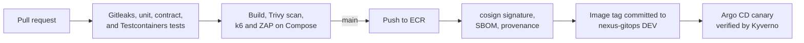
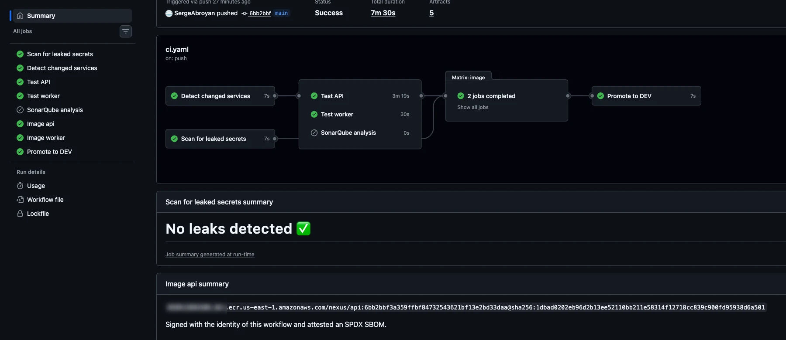
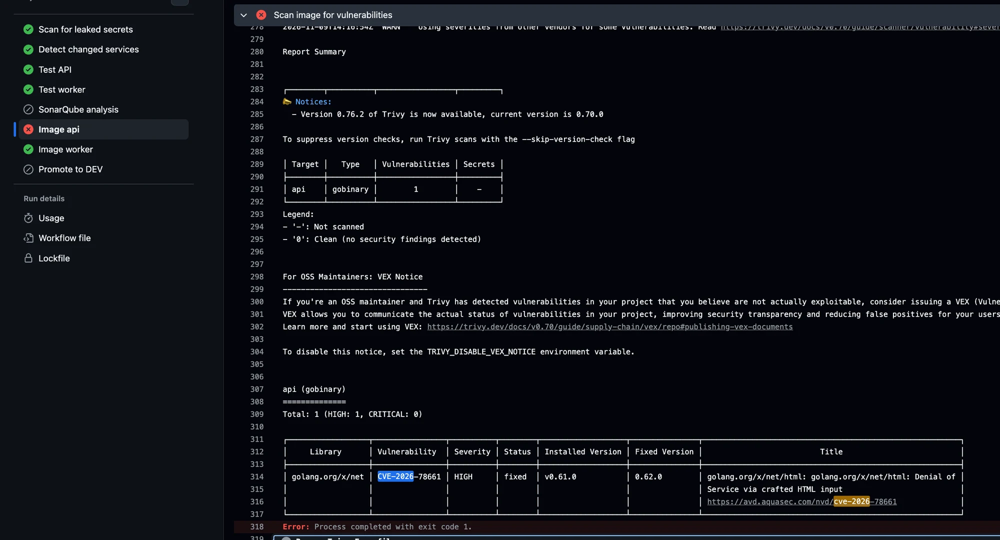
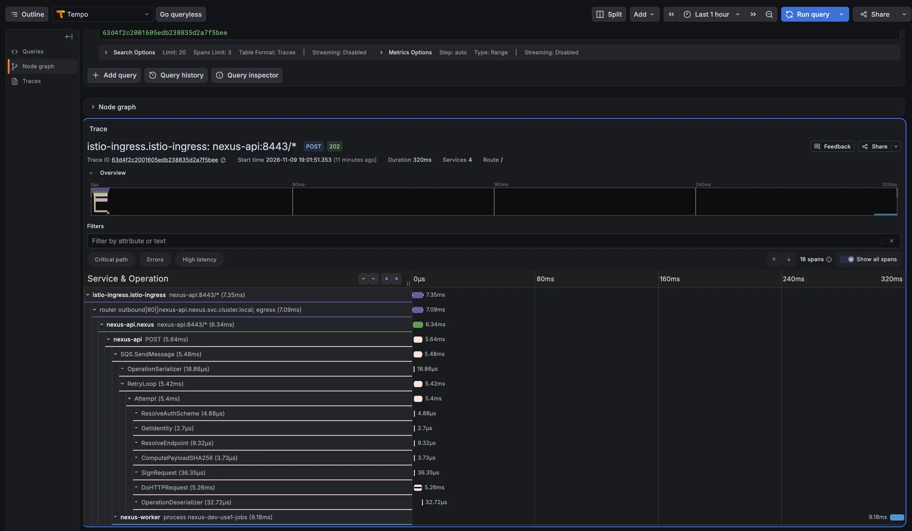
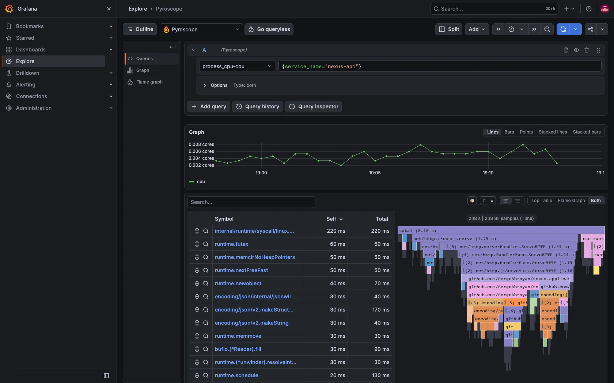

# Nexus Applications

The two services that run on the Nexus platform, and the pipeline that tests,
scans, signs, and delivers them. They are small on purpose: together they use
every part of the platform, from the database and cache to the queue, tracing,
and canary releases.

- `api` is a Go service that serves a small web page and a REST API, stores
  items in PostgreSQL, caches reads in Valkey, and sends notifications to an
  SQS queue.
- `worker` is a Java 25 Spring Boot service that reads the queue and processes
  the notifications.

## About Nexus

Nexus is a project I built to run a production-style platform on AWS from
start to finish: the infrastructure, the Kubernetes platform on top of it, and
two small services that use all of it. The services are deliberately simple;
the platform around them is the point. The work is split into three
repositories, the way a team would split ownership:

| Repository | What it holds |
| --- | --- |
| [nexus-platform](https://github.com/SergeAbroyan/nexus-platform) | AWS infrastructure with Terraform and Terragrunt |
| [nexus-gitops](https://github.com/SergeAbroyan/nexus-gitops) | Everything that runs inside Kubernetes, deployed by Argo CD |
| **nexus-applications** (this one) | The Go API, the Java worker, and their delivery pipeline |

The AWS environments cost money while they run, so I destroy them when I am
not using them; the services also run completely on a laptop with Docker, as
shown below. The screenshots come from the last rebuild of the platform, on
9 November 2026. More of them are on my portfolio at
[sergeabroyan.com/projects/nexus](https://sergeabroyan.com/projects/nexus/).

## What I built here

- **Two services, two languages.** A Go API and a Java worker connected by an
  SQS queue, each in its own folder with its own dependencies, tests, and
  Dockerfile.
- **One trace across the queue.** The API passes the trace context inside the
  queue message, so a single trace in Tempo follows a request from the gateway
  through the API and SQS to the worker that processed it.
- **Contracts that both sides test.** The message format is a JSON Schema in
  `contracts/` that the Go and Java tests both check, and an OpenAPI document
  describes every API endpoint, with a test that fails when an endpoint is
  documented but not tested.
- **Real dependencies in tests.** Integration tests start PostgreSQL, Valkey,
  and an SQS-compatible queue with Testcontainers.
- **A pipeline that refuses bad images.** Every pull request is scanned for
  secrets. A change to a service runs that service's unit, contract, and
  integration tests and a Trivy scan that fails on any fixable high or
  critical vulnerability, and then a k6 load test and an OWASP ZAP scan
  against the full stack in Docker Compose. ZAP also runs every week.
- **Signed releases.** On `main`, CI pushes each image to ECR, signs it with
  cosign without any stored key, attaches an SBOM, and commits the new tag to
  DEV in `nexus-gitops`. The `Deploy` workflow promotes the same image to
  staging and production, which needs an approval; nothing is rebuilt between
  environments.
- **Observable from the start.** Structured JSON logs, Prometheus metrics,
  OpenTelemetry traces, and continuous profiling with Pyroscope in both
  services.
- **Written decisions.** Eight [architecture decision records](docs/adr/README.md)
  explain the main choices.




## See it running

| | |
| --- | --- |
|  |  |
| A green pipeline: tests, scans, a signed image, and promotion to DEV | Trivy stopping a release over a CVE published the week before |
|  |  |
| One request traced from the gateway through the API and SQS to the worker | Where the API spends CPU under load |

## Run it on your laptop

You only need Docker. Start PostgreSQL, Valkey, a local SQS, the API, and the
worker:

```bash
docker compose up --build --wait
```

Open <http://localhost:8081>, add an item, and send a notification; the
worker's log shows it arriving with `docker compose logs --follow worker`.
Stop everything with `docker compose down`.

To see the traces, logs, metrics, and profiles as well, add the observability
overlay and open Grafana at <http://localhost:3000>:

```bash
docker compose -f compose.yaml -f compose.observability.yaml up --build --wait
```

Run the tests with Go and Java installed, or inside the build images as
[Local development](docs/local-development.md) shows:

```bash
cd services/api && go test -race ./... && go test -race -tags integration ./...
cd services/worker && mvn verify
```

## Connect it to AWS

Without any settings, CI still tests, builds, and scans every change; it only
skips publishing. Once the infrastructure from `nexus-platform` exists, add
these in the repository settings to let it push, sign, and deploy:

- variable `AWS_ROLE_ARN`, the `application_ci_role_arn` output of the
  `global` unit, and variable `AWS_REGION`, for example `us-east-1`;
- secret `GITOPS_TOKEN`, a token that can write to `nexus-gitops` only;
- under Actions → General, **Allow GitHub Actions to create and approve pull
  requests**, which Release Please needs for its release pull requests;
- a `production` environment with a required reviewer for the `Deploy`
  workflow.

[CI and delivery](docs/ci-cd.md) explains each step of the pipeline and how
versions move between environments.

## What went wrong along the way

Building and running the platform found real problems, and each one is fixed
in code. A few that involve these services:

- A one-line API change failed CI at the image scan. A high-severity flaw in a
  Go dependency had been published after the previous build, so I updated the
  dependency, scanned both images locally the same way CI does, and released.
- The worker never scaled down, because its idle memory sat above the
  autoscaler's memory trigger.
- The API's own metrics never reached Prometheus, because the port that Istio
  uses to merge them was not declared on the pod.

The full list, with causes, fixes, and lessons, is at
[sergeabroyan.com/incidents](https://sergeabroyan.com/incidents/).

## Repository layout

```text
services/
├── api/          Go service: HTTP server, PostgreSQL, Valkey, SQS, OpenAPI document
└── worker/       Java 25 Spring Boot service: SQS consumer
contracts/        JSON Schema and example of the notification message
compose.yaml      The full stack for local runs and CI tests
load/             k6 load test
.zap/             OWASP ZAP rules
docs/             Guides and decision records
.github/workflows/  CI, deployment, load test, security scan, releases
```

## Documentation

| Page | Contents |
| --- | --- |
| [Architecture](docs/architecture.md) | Repository structure, the API, the worker, and the message contract |
| [Configuration](docs/configuration.md) | Environment variables of both services |
| [Local development](docs/local-development.md) | Running and testing everything on a laptop |
| [CI and delivery](docs/ci-cd.md) | Pipelines, releases, the `Deploy` workflow, and repository settings |
| [Decision records](docs/adr/README.md) | Why each major choice was made |
