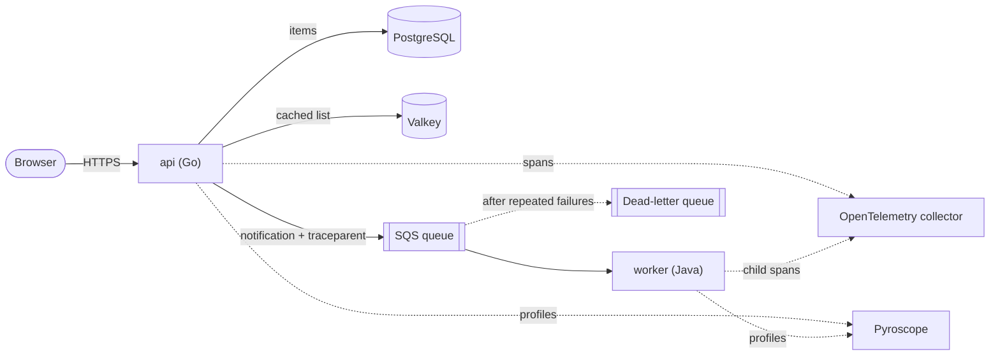
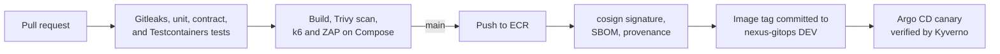

# Nexus Applications

The services that run on the Nexus platform and the supply chain that ships
them. A Go API and a Java worker, connected by SQS, are intentionally small in
scope and broad in coverage: together they exercise the database, the cache,
the queue, distributed tracing, canary releases, and admission control.

## Nexus

Nexus is a production-style platform I designed and built end to end: AWS
infrastructure, a GitOps-managed Kubernetes platform, and two services that
exercise it. Ownership is split across three repositories:

| Repository | Responsibility |
| --- | --- |
| [nexus-platform](https://github.com/SergeAbroyan/nexus-platform) | Account-wide resources, networking, EKS, data services, edge, Argo CD installation |
| [nexus-gitops](https://github.com/SergeAbroyan/nexus-gitops) | Every workload and add-on inside the clusters, reconciled by Argo CD |
| **nexus-applications** | Go API, Java worker, and the supply chain that builds, signs, and promotes them |

The AWS environments are ephemeral; the complete stack also runs locally with
Docker Compose. A walkthrough with screenshots is on
[sergeabroyan.com/projects/nexus](https://sergeabroyan.com/projects/nexus/).

## Services

| Service | Stack | Role |
| --- | --- | --- |
| `api` | Go 1.27, `net/http`, pgx, Valkey client, AWS SDK v2 | Web page and REST API; stores items in PostgreSQL, caches reads in Valkey, publishes notifications to SQS |
| `worker` | Java 25, Spring Boot 4.1 | Long-polls SQS, validates and processes notifications, finishes its batch on shutdown |



The API exposes `GET` and `POST /api/items`, `POST /api/notify`,
`GET /api/version`, liveness and readiness probes, Prometheus metrics, and its
own OpenAPI 3 document at `/api/openapi.yaml`. Reads go through Valkey with a
short TTL; writes invalidate the cache, and a cache failure degrades to the
database instead of failing the request. Versioned migrations run at startup
under a PostgreSQL advisory lock, and every schema change stays compatible with
the previous release, because canaries run both versions side by side.

## Engineering practices

- **Contracts as documents.** The queue message is a JSON Schema in
  `contracts/` that both the Go and the Java test suites enforce. The OpenAPI
  document is validated against real responses, and the build fails when an
  operation is documented but not tested.
- **Tests against real dependencies.** Integration tests start PostgreSQL 18,
  Valkey 9.1, and ElasticMQ with Testcontainers.
- **One trace per request.** The API propagates W3C trace context inside the
  SQS message, so a single trace spans the gateway, the API, the queue, and the
  worker.
- **Observable by default.** Structured JSON logs, Prometheus metrics,
  OpenTelemetry traces, and continuous profiling with Pyroscope in both
  services.
- **Trunk-based delivery.** Short-lived branches, every merge to `main` is
  releasable, and images are built once and promoted unchanged.

## Supply chain



| Stage | What it enforces |
| --- | --- |
| Pull request | Gitleaks over the history; for each changed service, unit, contract, and integration tests, an optional SonarQube quality gate, and a Trivy scan that fails on any fixable high or critical vulnerability |
| Compose stack | A k6 load test that fails above 0.5% errors or a 99th percentile over 500 ms, and an OWASP ZAP baseline scan, also run weekly |
| Merge to `main` | Images tagged with the commit SHA, pushed to ECR, signed keylessly with cosign, attested with an SPDX SBOM and build provenance, and committed to DEV in `nexus-gitops` |
| Promotion | The `Deploy` workflow verifies each signature before writing a tag to `staging` or `production`, and refuses production unless the environment requires an approval |
| Admission | Kyverno admits only images signed by this repository's CI workflow on `main` |

Release Please maintains versions and changelogs per service from Conventional
Commits; deployments always reference the immutable SHA tag.

## Key decisions

| Decision | Record |
| --- | --- |
| A Go API and a Java worker communicate through SQS | [ADR 0001](docs/adr/0001-api-and-worker-over-a-queue.md) |
| One trace follows a request through the queue | [ADR 0002](docs/adr/0002-one-trace-across-the-queue.md) |
| The API applies versioned migrations at startup | [ADR 0003](docs/adr/0003-migrations-applied-by-the-api.md) |
| Every image is signed and carries an SBOM | [ADR 0004](docs/adr/0004-signed-images-sboms-and-provenance.md) |
| HTTP and queue contracts are documents that tests enforce | [ADR 0005](docs/adr/0005-contracts-tested-on-both-sides.md) |
| No feature flag service | [ADR 0006](docs/adr/0006-no-feature-flags.md) |
| Release Please for versions, commit SHAs for images | [ADR 0007](docs/adr/0007-release-please-and-sha-tags.md) |
| Any version deploys to any environment from this repository | [ADR 0008](docs/adr/0008-deploy-workflow-in-the-application-repository.md) |

## See it running

| | |
| --- | --- |
|  |  |
| Tests, scans, a signed image, and promotion to DEV | The Trivy gate stopping an image with a fixable high-severity CVE |
|  |  |
| One request traced through the gateway, the API, SQS, and the worker | CPU profile of the API under load |

## Running locally

Docker is the only requirement. Start PostgreSQL, Valkey, ElasticMQ, the API,
and the worker:

```bash
docker compose up --build --wait
```

The web page is at <http://localhost:8081>; `docker compose logs --follow
worker` shows each notification being processed. Add the observability overlay
for traces, logs, metrics, and profiles in Grafana at <http://localhost:3000>:

```bash
docker compose -f compose.yaml -f compose.observability.yaml up --build --wait
```

Run the test suites:

```bash
cd services/api && go test -race ./... && go test -race -tags integration ./...
cd services/worker && mvn verify
```

[Local development](docs/local-development.md) covers running the tests inside
the build images and load testing the local stack with k6.

## Connecting to AWS

Without repository settings, CI tests, builds, and scans every change and
skips publishing. Once `nexus-platform` has created the infrastructure:

- variable `AWS_ROLE_ARN`, the `application_ci_role_arn` output of its `global`
  unit, and variable `AWS_REGION`;
- secret `GITOPS_TOKEN`, scoped to write `nexus-gitops` only;
- **Allow GitHub Actions to create and approve pull requests**, for Release
  Please;
- a `production` environment with a required reviewer.

[CI and delivery](docs/ci-cd.md) describes each job and the promotion model.

## Repository layout

```text
services/
├── api/            Go service, migrations, OpenAPI document
└── worker/         Spring Boot service
contracts/          JSON Schema and example of the queue message
compose.yaml        Full local stack, also used by CI
compose.observability.yaml   Overlay with Grafana's all-in-one observability image
load/               k6 load test
.zap/               OWASP ZAP rules
docs/               Architecture, configuration, delivery, decision records
.github/workflows/  CI, deployment, load test, security scan, releases
```

## Documentation

| Page | Contents |
| --- | --- |
| [Architecture](docs/architecture.md) | Repository structure, the API, the worker, and the message contract |
| [Configuration](docs/configuration.md) | Environment variables of both services |
| [Local development](docs/local-development.md) | Running and testing everything on a laptop |
| [CI and delivery](docs/ci-cd.md) | Pipelines, releases, the `Deploy` workflow, and repository settings |
| [Decision records](docs/adr/README.md) | Context and consequences of each major choice |
